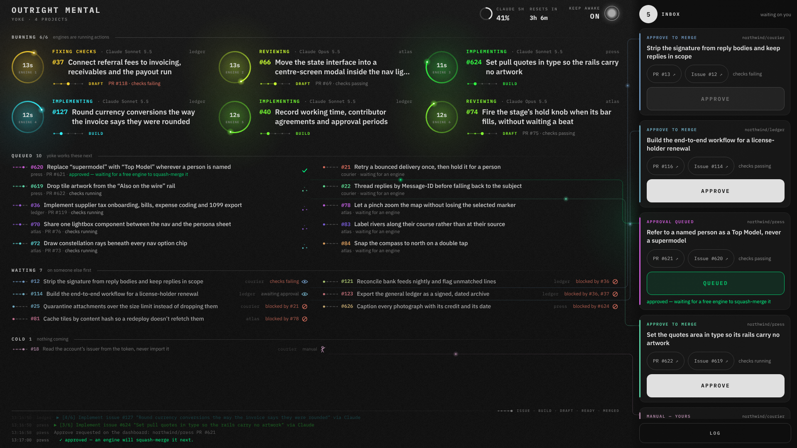
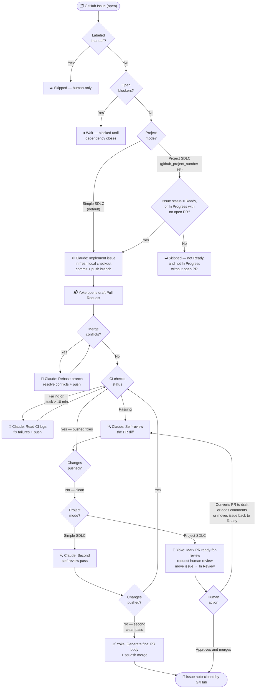

[](https://github.com/outrightmental/yoke/actions/workflows/test.yml)

# Yoke

**Yoke a team of coding agents to work through a GitHub issue queue.**

`yoke` is a TypeScript orchestrator that closes the loop on agentic software development. Write issues. Yoke handles the rest: it picks up each issue, asks Claude to implement it in a local checkout, opens a draft pull request, self-reviews the diff, fixes anything that needs fixing — review comments, merge conflicts, failing CI — writes a polished final description, and squash-merges. Then it moves on to the next issue.

It is for developers who want the creative part of software development — expressing intent and reviewing outcomes — without babysitting every agent handoff.



## Why this exists

Modern coding agents are powerful, but they still need a conductor — someone to decide what starts next, avoid overloading the repo, notice blocked tasks, run a review pass, route fixes back for another round, preserve closing references, and merge the finished work.

`yoke` makes that conductor programmable and autonomous, with Claude as the worker behind every step.

Give your repository a prioritized issue backlog and run the loop. The project becomes a living assembly line:

```text
issues → Claude implementation → PR → self-review → fixes → squash merge
```

## For the solo developer

Yoke is a force multiplier for a solo developer who wants to stay in the creative and strategic flow. You decide what matters — write the issues, set the acceptance criteria, shape the architecture. Yoke handles the mechanical work:

- **Picks up the next unblocked issue automatically**, so you never lose momentum between tasks.
- **Implements, reviews, and merges in the background** while you focus on design, testing, and product direction.
- **Resolves merge conflicts quietly** — when branches diverge, Yoke asks Claude to rebase and fix the conflicts before continuing the review cycle, without you ever touching a rebase command.
- **Fixes failing CI without being asked** — it reads the check logs and pushes a fix.
- **Keeps the PR queue clean** — only finished, merged work accumulates; no half-baked draft PRs or stale branches.
- **Respects your control** via the `manual` label — apply it to any issue or PR you want to keep under your direct hand.

The result: you stay in your highest-value role while Yoke pulls weight in the background to maintain the project's forward momentum.

## SDLC decision tree

The diagram below shows the full lifecycle of an issue through Yoke, covering both **Simple SDLC** (fully automated, the default) and **Project SDLC** (human-in-the-loop via a GitHub Projects board).



## Simple SDLC

In Simple SDLC mode — the default for any project whose `env.yaml` entry has no `github_project_number` — Yoke runs fully autonomously from issue to merged PR:

1. Any open, unblocked, non-`manual` issue is eligible to start.
2. Issues are prioritized bugs-first, then by milestone, then by creation time.
3. Claude implements, the PR opens as a draft, Claude self-reviews twice (CI gates apply after any code-changing pass; two consecutive clean passes trigger the merge), and Yoke squash-merges — no human action required.
4. Merge conflicts and CI failures are handled quietly in the background.

This mode is ideal for personal projects, greenfield work, and any context where CI and branch protections serve as the safety net.

## Project SDLC (Human-in-the-Loop)

Enable Project SDLC per project by setting `github_project_number` in `env.yaml` to a GitHub Projects v2 board number. This mode adds a human review gate before any merge:

1. Issues in **Ready** status are picked up, and issues already in **In Progress** are also picked up if they have no open PR linked and no active agent session already running.
2. When work starts on a Ready issue, it moves to **In Progress**.
3. After one clean self-review, Yoke marks the PR ready-for-review, requests human review, and moves the issue to **In Review** — it never auto-merges.
4. Yoke resumes work automatically if:
   - A human converts the PR back to a draft (wants more changes).
   - A new review comment arrives on the PR.
   - The issue is moved back to **Ready** on the project board.

List the GitHub logins to notify when a PR is ready under the project's `reviewers` key in `env.yaml`.

This mode suits teams where a human QA or architect approves each merge, while Yoke handles the full implementation-review-fix loop.

## What it does

On every iteration, `yoke`:

1. Loads open GitHub issues, open pull requests, pending workflow approvals, and local agent-session state.
2. Builds a dependency-aware work plan from issue age plus relationships like `blocked by #123`, `depends on #123`, and `blocks #123`.
3. Enforces a configurable concurrency limit so the repo does not get flooded with half-finished work.
4. For each eligible issue, runs Claude locally in a fresh checkout to implement the change and open a draft pull request.
5. Checks CI status on every open PR — waits for passing checks before advancing, fixes failing checks, and escalates checks stuck for more than 10 minutes (timed from when the checks started, and only ever cancelling that PR's own stalled runs).
6. Detects merge conflicts and asks Claude to resolve them before continuing.
7. Asks Claude to self-review the diff and push fixes if needed. Requires two consecutive clean self-reviews before advancing.
8. Generates a polished final PR description with Claude, updates the PR body, preserves closing references, and squash-merges. Retries with `--admin` if GitHub's branch policy requires it.

When the Claude CLI reports that the subscription's usage limit is exhausted, `yoke` reads the reset time out of the CLI's own message and treats it as a hard hold on the whole engine pool: nothing is planned, claimed, checked out or run until it passes, and work resumes by itself the moment it does. GitHub-only maintenance (workflow approvals, reconciliation, the activity feed) keeps running throughout.

The hold is said once, not once per engine per cycle:

- **In the terminal**, a single line updates in place for the duration — `waiting 2h 14m until Sep 21, 8:50 AM for Claude usage limit` — with no repeated checkout output and no repeated identical failures behind it.
- **On the Dashboard**, the hold is said across the top of the field: what is being waited on, how much is left, and the wall-clock time it ends. It is replayed to a browser that connects mid-hold, so a reload never makes a parked run look merely idle.

GitHub rate-limit holds get the same treatment.

## The big idea

`yoke` treats GitHub as the source of truth and Claude as the worker behind every action:

- **Issues are intent.** Write clear issues and dependencies; the loop decides when they are safe to start.
- **Pull requests are work cells.** Each PR moves through review, fix, re-review, and merge phases automatically.
- **Local session state is memory.** A small persisted session store prevents duplicate work and lets each loop cycle pick up where the last one stopped.
- **Humans stay in control.** You own the backlog, repository settings, branch protections, CI, and review standards.

See the deeper docs:

- [Design overview](design/SPEC.md)
- [Agent loop and PR lifecycle](design/AGENT_LOOP.md)
- [The Dashboard: the field and the inbox](design/DASHBOARD.md)

## Quick start

Install dependencies:

```bash
npm install
```

Log in to Claude Code (once, if not already done):

```bash
claude login
```

Create `env.yaml` from the template, then add a GitHub PAT under `github_tokens` and the repositories to run under `projects`:

```bash
cp env.example.yaml env.yaml
# edit env.yaml: set github_tokens[0].token and projects[].github_repository
```

`env.yaml` is the only place Yoke reads settings from (it is git-ignored). See [Configuration](#configuration) for every key.

Run a safe one-shot preview:

```bash
npm start -- --dry-run --once
```

Run the real loop:

```bash
npm start
```

Yoke loads `env.yaml` from the current working directory and works every repository listed under `projects`; there are no positional CLI arguments.

## Dashboard

`yoke` opens a single real-time **Dashboard** in your browser at `http://localhost:3000` (change the port with `dashboard_port`) when the loop starts. One dashboard covers **all** configured projects: there is a single shared pool of `max_concurrency` engines, and each project's own `max_concurrency` caps how many of those engines may work it at once. When more than one project is configured, every piece of work, inbox card, feed card, and event-log line is labelled with the project (`owner/repo`) it belongs to; with a single project the name appears at the top only.

The Dashboard is two things. **The field** is one canvas the size of the window, on which the state of the whole run is drawn. **The inbox** runs down its right-hand edge, top to bottom, and holds everything you can *do* about it. There are no panels: nothing has a box of fixed size to be fitted into.

### The field

- **Heat rises.** Work is laid out by how much token burn it stands for right now, hottest at the top and with the most room:
  - **BURNING** — an engine is running an action on it. Each gets a *reactor*: the engine's ring with a comet turning on it and the action's running time inside, and beside it the action (`IMPLEMENTING`, `REVIEWING`, `FIXING CHECKS`, `RESOLVING CONFLICTS`, `MERGING`), the model running it, and the work's number and title.
  - **QUEUED** — Yoke works it next, with nothing but its own pipeline in the way: the PR's checks are running, an approved PR waits for its squash-merge, or an open PR or ready issue waits for a free engine.
  - **WAITING** — it waits on someone else first: a PR ready for review or parked for your approval, or an issue blocked by other issues.
  - **COLD** — nothing is coming: a `manual` PR, a merged PR, an issue out of the queue (Backlog, Done) — and every piece of work once Yoke is shutting down.

  A level with nothing in it takes no room at all. When the window cannot hold everything, the whole field steps down to denser sizes before it ever scrolls; when it does scroll, drag it or use the wheel.

- **A line for every piece of work.** Below the reactors, each piece of work is one line: a track of five marks saying how far along the lifecycle it is — *issue · build · draft · ready · merged*, coloured up to the one it has reached — then its number, its title, and the one thing it is waiting on (`checks running`, `blocked by #36`, `ready — waiting for your approval`, `approved — waiting for a free engine to squash-merge it`). A line that is only waiting its turn for an engine says nothing, since its stratum already does. At the end of the line a small mark says the same at a glance:
  - *three points in orbit* — its PR's GitHub Actions checks are queued or running, which is why no engine is working it
  - *blinking eye* — its PR is ready for review
  - *person* — its PR is labelled `manual`, so Yoke leaves it to you
  - *check* — approved and waiting for its merge (green), or merged
  - *cross* — its checks are failing; *barred circle* — it is blocked by other issues

- **Engines.** The header of the top stratum says how many engines of the pool are burning. The ones that are not sit on *the bench* under the reactors: a small ring with the engine's number, and what it is waiting on — the time to its next cycle, or the limit that is parking it. An engine keeps its place: reactors are set in engine order, in columns fixed by the size of the pool, so a reactor never changes width because the engine beside it stopped.

- **Colour says which, and how hot.** Each piece of work is drawn in its issue's own stable colour — derived from the issue number, so an issue keeps the same colour forever — and its inbox card, its engine's ring, and its lines in the event log use that same colour. Work for a PR that closes no issue takes the PR number's own colour. How *saturated* the colour is shows how much token burn the work stands for right now, judged by its state, not by measured usage: full saturation while an engine burns on it, strong when queued, muted when waiting, faint when cold. The hue still tells you *which* issue, and the saturation *how hot* it is, and the same level is the same colour wherever it is drawn. Even the faint level keeps a trace of the issue's hue, so finished work never reads as trim.

  Everything else on the Dashboard is plain gray with no hue at all: the field's ground and rules, its labels, the instruments along its top, the inbox's surfaces, idle engines. Saturated colour is kept for the work engines burn tokens on, and gray never stands for any of it. The only other colours are alerts and outcomes: red for an error or a lost connection, orange for a hold or a shutdown, amber for a warning, and green for an approval going through. The canvas paints with the same colour tokens as the stylesheet, so the rule holds for what is painted as well as for what is styled.

- **Things move when their state does.** A piece of work is the same thing wherever it is drawn, so when its checks pass it slides up a stratum, and when an engine takes it the engine's ring swings out from the bench to it, and back when the action is done. A ring spreads from the mark of any piece of work whose state has just changed. Nothing moves otherwise: an open Dashboard repaints only the comets and the few marks in motion, and nothing at all while no engine is burning. If your system asks for reduced motion, nothing loops and nothing glides.

- **Instruments** run along the top: the Dashboard's title, the cycle number, the countdown to the next cycle, the Claude usage gauge, and the keep-awake lamp.

  - **Claude usage gauge**: a ring that fills as your Claude account's usage window is used (it turns amber at 70% and red at 90%), with the time until that window resets (**RESETS IN**) — so you can plan work against the capacity that is left *before* a usage-limit hold parks every engine. Anthropic reports a rolling 5-hour window (**CLAUDE 5H**) and a weekly one (**CLAUDE 7D**), though an account may have only the weekly one; of those it reports, the gauge shows whichever is nearer its limit, since that is the one that will stop work first. Yoke reads it from Anthropic's usage endpoint once a minute with the login the Claude CLI already uses (or with `anthropic_usage_token`, when set), and every open Dashboard is updated with each reading. The startup banner says which, and the log gets a `Claude usage:` line for the first reading and whenever it changes — another 10% of the window used, a new window, the gauge moving to the other window, or no reading and why. When the Claude CLI is not logged in to a Claude account and no token is set, the gauge reads **OFF**. When a read fails after a good one — Anthropic is overloaded (HTTP 529), rate-limits the read, cannot be reached or rejects the token — the gauge keeps showing the last good numbers until a read succeeds again or their window resets, rather than blinking out for a minute. Whenever there is no reading it can trust — before the first one arrives, when reads fail before any has succeeded, after the window resets, or once readings have stopped arriving for more than five minutes — it goes dark and reads **—** rather than showing a number that may be wrong. While a Claude usage limit is parking the engines, the gauge reads **LIMIT** in red and **RESETS IN** counts down to the reset time the Claude CLI gave, whatever the last reading said. Tap the gauge to read why it shows what it shows.

  - **Keep-awake lamp**: the **ON** light at the top right of the field is not a drawing — it is a tiny looping, muted video, playing for as long as the Dashboard is open. An actively playing video is the one thing observed to stop a locked-down laptop sleeping or locking mid-run, so the Dashboard plays one itself instead of you parking a full-screen YouTube video next to it. There is nothing to switch on: it runs whenever the Dashboard is open, not only while engines are working, and the Screen Wake Lock API is requested alongside it wherever the browser allows. If the browser refuses to autoplay the loop, the lamp turns amber and reads **CLICK**, and a card at the top of the inbox offers to start it — one tap there, or a click or keypress anywhere on the page, does.

- **A hold** on the whole pool — a Claude usage limit, a GitHub rate limit — is said across the top of the field: what is being waited on, how much is left, and the wall-clock time it ends, in your browser's own time zone. It is replayed to a browser that connects mid-hold, so a reload never makes a parked run look merely idle.

- **The last lines of the event log** run along the bottom of the field. Tap them — or **Log**, at the foot of the inbox — to draw up the activity drawer: the whole event log, and the feed of GitHub activity beside it.

- **Tap anything** on the field — a piece of work, an engine, the usage gauge, a hold — and a card at the foot of the inbox says the rest: the whole title, where it stands, and links to the issue and the PR on GitHub. (A touch screen has nothing to hover with, so nothing on the Dashboard depends on hovering.)

Everything the field draws is also there as ordinary markup, out of sight, for a screen reader and the keyboard: the engines, each stratum, and every piece of work as a link to GitHub. Tabbing through it moves a focus ring across the canvas.

### The inbox

The inbox is every interaction the Dashboard offers, in one place: down the right-hand edge of the screen, top to bottom — where the hand of someone using a touch screen right-handed already is, and where reaching for it never puts an arm across the picture. Every target on it is at least 44 pixels tall, and the one button a card exists for is 56. With nothing in it, it folds away to a strip — a count, and the Log button — and gives its room to the field; on a screen too narrow to share, the field keeps the strip's width and the open inbox lies over it instead (tap the count to open and close it). The browser tab's title carries the count too, for when the Dashboard is not the tab in front.

It is federated: each kind of thing that needs a person comes from its own source, and they are listed together, the most pressing kind first and, within a kind, the longest-waiting on top:

- **Keep awake** — the browser refused to start the keep-awake loop; one tap starts it.
- **Approve to merge** — a PR parked by the [`review` label](#the-review-label), with an **Approve** button (below).
- **Ready for your review** — in [Project SDLC](#project-sdlc-human-in-the-loop), a PR Yoke has asked a person to review on GitHub, with a button that opens it there.
- **Failed …** — an action an engine ran that failed, with the first line of why. Yoke retries a failed action by itself, so there is nothing you must do; the card is there because a failure used to be one red line scrolling out of the log. It leaves when an engine takes the work up again, or when you dismiss it.
- **Manual — yours** — a PR labelled `manual`, which Yoke leaves to you, with a button that opens it on GitHub.

A card about a piece of work is edged in that work's colour and joined to it by a line across the field, so you can see what a card is about without reading it. The line runs out from the work to a gutter beside the inbox and up or down it to the card — never across the text — and a point travels along it: towards the card while the work waits on you, and back from it, in green, once you have acted.

The list never moves a button under your finger. A card stays where it is however it changes, a new one lands below the others of its kind, and for a moment after a card has arrived or moved — when the card above it has left, say — its button takes no press.

**Approve.** A PR parked by the `review` label — ready, self-reviewed clean, and waiting on a human — has a card with an **Approve** button. Press it — one press; there is no confirming second one — and Yoke squash-merges that PR the way it would have without the label: as a normal `squash-merge` action on an engine, which shows on the field as a reactor, waits out any usage-limit hold, and starts within a few seconds if an engine is free. Some details:

- The approval covers that one PR. The `review` label stays where it is, so the issue's other PRs still wait for a human.
- It never merges over failing checks: the button is greyed out while they fail. If the checks are still running, it approves a merge that waits for them to pass.
- Once approved, a PR stays approved until it merges. If it needs work first — checks that fail after you approve, merge conflicts, or a re-review after new comments or a return to draft — Yoke does that work and then squash-merges it, without asking for approval again.
- Yoke records the approval in its session store and comments on the PR (`Approved on the yoke dashboard…`), so it shows on GitHub too.
- From the instant you press, the button reads **Queued**: the approval is waiting for an engine to pick it up. It stays Queued while Yoke reads the PR from GitHub and waits for an engine to finish planning, and — once Yoke has recorded the approval — until an engine is free to carry it out, however long that takes. The moment one starts, it reads **Approving** — while the engine squash-merges the PR, or fixes it first (failing checks, merge conflicts, new comments) — then **Merged**. The card follows Yoke's own reports, never a timer, and the button is the same size in every step, so nothing moves as it changes. A line under the button says what it is waiting on: `queued — sent to yoke…`, `queued — reconnecting to yoke…`, `queued — yoke is reading PR #630 from GitHub…`, `queued — waiting for an engine to finish planning…`, `approved — waiting for a free engine to squash-merge it`, `approved — an engine squash-merges it once its checks pass`, `approving — an engine is squash-merging it`, `approving — an engine is resolving its merge conflicts, then it squash-merges`. A dashboard approval goes ahead of every engine's queued planning pass, so it waits for at most the one already under way.
- A press never falls back to **Approve** as if it had not happened, and never gives up on its own. Until Yoke answers it stays **Queued**: a press made while the Dashboard is not connected, or sent and not answered before the connection dropped, is sent again when it reconnects (`queued — reconnecting to yoke…`), and one with no answer ten seconds on reads `queued — sent to yoke, no answer yet…`. If Yoke does not approve it, the button reads **Retry** and the line says why, for as long as the card is there: `not approved: its checks are failing`, or `approval failed: …` for an unexpected error. Press Retry to send it again.
- Pressing again while an approval is under way starts no second one, and a press that finds the PR already approved, or an engine already working on it because of its approval, reads as approved, not as a refusal. Every open Dashboard shows an approval in progress, wherever it was pressed, and a page opened or reloaded meanwhile still shows it; how another Dashboard's approval ended shows for a minute.
- Every request and its outcome, including refusals and why, is also written to the event log, with how long it took and how long it waited for the planner.
- Only the Dashboard's own page can approve. A request from a page on any other site, or from the Dashboard opened by a name other than an IP address, `localhost` or the host it listens on, is refused, and that page alone is told why.
- There is no Approve button in Project SDLC, where every PR waits for a human on GitHub: there the inbox lists it as **Ready for your review** instead.

### Shutting down

Once a graceful shutdown is requested, the field goes cold: every piece of work sinks to the bottom stratum at its faintest, and its mark, if it had one, freezes in place — it stays the mark the work had when the shutdown was requested. An engine still finishing its action goes on burning beside its work, since it is; when it stops, its ring goes back to the bench in orange and reads *shut down*. The instruments say **STOPPING**, then **SHUT DOWN**. No engine starts new work after the request, and nothing will keep the field live, so whatever it shows from then on is no longer current.

To prevent the Dashboard from opening automatically, pass `--no-browser`:

```bash
npm start -- --no-browser
```

The Dashboard server still starts; the URL is printed to stdout so you can open it manually.

**Graceful shutdown**: Press **Escape** (or **Ctrl+C** once) while the loop is running to let Yoke finish any in-flight actions before exiting. From that moment no engine plans, claims, or starts a new action — GitHub-only maintenance still finishes. Press **Ctrl+C** a second time to exit immediately, discarding in-flight runs.

## Requirements

- Node.js 18+
- `git` on `PATH`.
- A GitHub PAT, listed under `github_tokens` in `env.yaml`.
- The `claude` CLI (Claude Code) installed locally, on `PATH`, and logged in via `claude login`. Uses your Claude Code subscription — no API key required.

## Configuration

All configuration lives in `env.yaml` in the working directory; copy `env.example.yaml` to create it. No configuration is read from environment variables. Yoke uses the GitHub PAT from `github_tokens` directly for API calls and Git clone/fetch/push operations. Claude Code authentication is still handled by the `claude` CLI: `ANTHROPIC_API_KEY`, `GITHUB_TOKEN`, `GH_TOKEN`, and `YOKE_GITHUB_TOKEN` (plus the legacy `VIBRATOR_GITHUB_TOKEN`) are removed from the environment of every Claude subprocess, so the agent authenticates only through your Claude Code login and the configured PAT.

**GitHub token permissions**

Fine-grained PATs need access to the target repository with:

- Metadata: read
- Contents: read/write
- Pull requests: read/write
- Issues: read/write
- Actions: read/write
- Checks: read
- Commit statuses: read
- Projects: read/write, if using project mode
- Workflows: write, if the agent may push workflow file changes

Classic PATs may need `repo`, `project` when using project mode, and `workflow` when the agent may edit or push workflow files.

**Global keys** (top level of `env.yaml`)

| Key | Default | Purpose |
| --- | --- | --- |
| `github_tokens` | — | **Required.** List of named GitHub PATs, each `{ name, token, default? }`. Projects that set no `github_token_name` use the entry marked `default: true`, or the first entry. |
| `projects` | — | **Required.** List of repositories to run; see the per-project keys below. |
| `max_concurrency` | `3` | Total size of the shared engine-cylinder pool across all projects. |
| `cycle_minimum_seconds` | `60` | Minimum seconds between engine cycle starts. |
| `claude_code_initial_model` | `claude-sonnet-4-6` | Claude model used during initial implementation. |
| `claude_code_review_model` | `claude-opus-4-8` | Claude model used during self-review. |
| `claude_code_initial_effort` | `high` | Reasoning effort for initial implementation. |
| `claude_code_review_effort` | `high` | Reasoning effort for self-review. |
| `claude_describe_model` | `claude-haiku-4-5-20251001` | Claude model used to write the final PR description before merge. A faster model is appropriate here. |
| `claude_timeout_seconds` | `10800` (3 h) | How long one Claude run may take before it is killed. Size it to the scope of your issues — generation is server-side, so a large implementation takes the time it takes regardless of your machine. A run cut short is salvaged as an incomplete draft PR rather than discarded. |
| `dashboard_port` | `3000` | HTTP port for the single shared Dashboard server. |
| `dashboard_title` | `Outright Mental` | Title displayed in the Dashboard header. |
| `anthropic_usage_token` | the Claude CLI's login | Optional. OAuth access token of the Claude account whose usage the Dashboard's usage gauge shows. Without it, Yoke reads usage with the `claudeAiOauth.accessToken` the Claude CLI is logged in with (`~/.claude/.credentials.json`; on macOS, the Keychain item `Claude Code-credentials`), re-read on every poll so the CLI's own renewals are picked up; Yoke never renews it itself. If the CLI has not run for long enough that its login has expired, the gauge holds its last reading until that window resets, then goes dark until the next `claude` run renews it. Set this to read a different account. It must be a Claude **login** token, which carries the `user:profile` scope needed to read usage: inference-only tokens from `claude setup-token` and Console API keys cannot read usage. Login tokens expire — if hovering the gauge says the token was rejected, copy in a fresh one. Sent only to `api.anthropic.com`, and never to the browser. |
| `github_api_base_url` | `https://api.github.com` | GitHub REST API base URL, for GitHub Enterprise. |
| `github_api_version` | `2022-11-28` | Value of the `X-GitHub-Api-Version` request header. |

**Per-project keys** (each entry under `projects`)

Per-project values override the global ones for that project.

| Key | Default | Purpose |
| --- | --- | --- |
| `github_repository` | — | **Required.** Repository slug in `owner/repo` form. |
| `github_token_name` | default token | Name of the `github_tokens` entry to use for this project. |
| `max_concurrency` | global `max_concurrency` | Cap on how many of the shared cylinders may work this project at once. Never exceeds the global pool. |
| `github_project_number` | — | GitHub Projects v2 board number. Enables [Project SDLC](#project-sdlc-human-in-the-loop) for this project. |
| `reviewers` | `[]` | GitHub logins to request review from (Project SDLC only). |
| `focus_mode` | `false` | When `true`, only issues labelled `focus` (and the PRs that advance them) are worked. |
| `claude_code_initial_model` / `claude_code_review_model` | global value | Per-project model overrides. |
| `claude_code_initial_effort` / `claude_code_review_effort` | global value | Per-project effort overrides. |
| `claude_describe_model` | global value | Per-project override for the final-description model. |
| `claude_timeout_seconds` | global value | Per-project override of the per-run timeout. |
| `cycle_minimum_seconds` | global value | Per-project override of the cycle minimum. |
| `session_store_path` | `<cwd>/.yoke/<owner>-<repo>-sessions.json` | Path for persisted local agent-session state. |

**CLI flags**

These are the only command-line options; there are no positional arguments.

| Flag | Purpose |
| --- | --- |
| `--once` | Run a single iteration, then exit. |
| `--dry-run` | Print the plan without executing any Claude or GitHub actions. |
| `--no-browser` | Start the Dashboard server but do not auto-open a browser window. |

Focus mode is a per-project setting, not a flag: set `focus_mode: true` on a project in `env.yaml` and Yoke will pick up only issues labelled `focus` in that repository, plus the PRs that advance them.

## Issue language the loop understands

Use normal GitHub issues, plus lightweight relationship phrases in the issue body:

```markdown
blocked by #12
depends on #12
blocks #34
```

`yoke` will not start an issue while any referenced blocker remains open. Older eligible issues start first (bugs first, then milestone order, then creation time), up to `max_concurrency`.

- Relationship phrases are read only from the issue author's own text. Anything inside a `>` blockquote, a `<details>` section, fenced or inline code, or an HTML comment is ignored, so a pasted email or quoted issue that says "blocked by #N" about some *other* issue never blocks this one.
- An issue can't block itself. A self-reference (in the body, a native dependency, or a sub-issue link) is dropped.
- Issues that block each other, directly or through a chain, form a dependency cycle. Yoke reports each cycle once in the event log, and its issues stay blocked until someone removes one of the "blocked by"/"blocks" references. Yoke never breaks a cycle on its own.

### The `manual` label

Apply the `manual` label to any issue or PR to remove it from automated work:

- **Issues** labeled `manual` are never picked up by Yoke.
- **PRs** labeled `manual` receive no automated actions (no self-review, no conflict resolution, no auto-merge) and do not count against `max_concurrency`.

Yoke creates the `manual` label in the repository on startup if it does not already exist.

### The `review` label

Apply the `review` label to an issue to opt it into the
**implement-then-wait-for-review** workflow
([outrightmental.com#409](https://github.com/outrightmental/outrightmental.com/issues/409)):
Yoke implements the issue, self-reviews, and fixes failing checks exactly
as usual — but after the clean self-review it marks the PR ready and **stops**.
The final PR is never squash-merged; it waits for a human. This is the flag
that automated intake (e.g. Mailbot's note-to-issue pipeline) applies so a
one-line emailed note becomes a reviewable PR without ever landing on `main`
unattended.

- Works in every mode; in Project SDLC it is redundant (that mode already never auto-merges).
- The label is copied onto the PR when it is opened, so the no-merge gate survives even if the issue is closed or relabelled mid-flight.
- A parked PR does not count against `max_concurrency`.
- Converting the PR back to draft, or commenting on it, re-queues it: Yoke addresses the feedback, self-reviews, and requests review again.
- Removing the label from both the issue and the PR returns the PR to the normal auto-merge flow.
- To merge it without leaving the Dashboard, press **Approve** on its card in the inbox (see [The inbox](#the-inbox)): Yoke squash-merges that PR exactly as it would have without the label, carrying it through any fixes, conflict resolution and re-review it needs first without asking again.

Yoke creates the `review` label in the repository on startup if it does not already exist.

### Milestone ordering

Milestones act as a priority queue, not a gate. Issues in earlier milestones are preferred over later-milestone issues, but all eligible unblocked issues can start regardless of milestone. Bug-typed issues (GitHub's native Issue Type = "Bug") always jump ahead of every other type.

Priority order: **Bug** > earlier milestone > later milestone > no milestone, then by creation time within each tier.

### Parent and sub-issues

GitHub sub-issues are understood natively. A parent issue is automatically blocked until all of its open sub-issues are resolved — no explicit dependency phrases needed.

## Development

```bash
npm test
npm run build
```

To work on the Dashboard without a token, a backlog, or an hour of waiting for something to happen, run it against a stand-in engine pool:

```bash
npm run demo:dashboard
```

That starts the real Dashboard server at `http://localhost:3000` and feeds it the events a real run emits, from a small simulation of the loop over a made-up backlog — an Approve press on the page is answered the way Yoke answers one, and nothing touches GitHub or Claude. `-- --scene=hold` (or `quiet`, `single`, `crowded`, `review`), `-- --shutdown-after=20`, `-- --fail=0.5`, `-- --speed=4` and `-- --port=4000` show it in other states; Ctrl+C once shuts it down gracefully, the way Yoke does, and twice exits. The screenshot at the top of this page is of `npm run demo:dashboard`.

The Dashboard's keep-awake loop (`src/dashboard/assets/keep-awake.{webm,mp4}`) is committed, so a normal build needs nothing extra. To change how the lamp looks, edit and re-run `tools/generate-keep-awake-video.py` — it needs Pillow and GStreamer, neither of which Yoke itself depends on — then commit the regenerated files.

## Status

This project is intentionally small and sharp: a local orchestrator, a GitHub client, a session store, a Claude agent client, and a planning engine. It is early infrastructure for people who want to run software projects as agentic systems instead of manually copying prompts between tabs.
